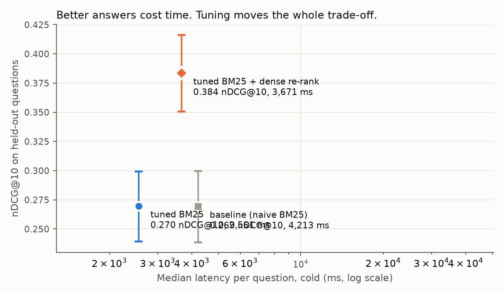
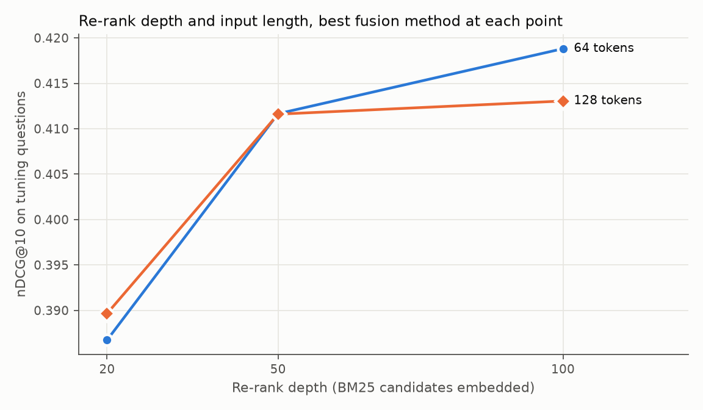

# 🔎 RAG Tuning Lab

A retrieval pipeline over a **1.5 GB, 2.68-million-passage Wikipedia corpus** that is built to be measured, optimized and tuned, not just run. It answers a question the way a RAG system does (find the right passages, pack them into a prompt, cite them), and every setting that affects quality or speed is swept and scored against thousands of questions with known right answers.

It runs on a laptop CPU. That constraint shapes the design, and the results below say what it costs.

This is original code. The corpus and questions come from the [BEIR](https://github.com/beir-cellar/beir) benchmark (Natural Questions) and are downloaded, not included. No code was copied from another project.

## What is in the pipeline

```
question
   │
   ▼
BM25 first stage ── SQLite FTS5 over all 2.68M passages (no extra dependency)
   │   settings tuned: stopwords, query-term pruning, title weight
   ▼
top-N candidates
   │
   ▼
dense re-rank ───── small embedding model, run ONLY on those candidates, vectors cached on disk
   │   settings tuned: embedding input length, re-rank depth, fusion method and weight
   ▼
top-k passages ──▶ prompt packer (token budget, numbered sources) ──▶ your LLM (any function)
                                                                      └─ or an extractive answer, no model needed
```

Embedding 2.68M passages on a CPU would take days, so the embedding model only ever sees the few dozen to hundred passages BM25 retrieves per question. That is a standard design, and a real constraint here.

## How the tuning is kept honest

- **Real questions with real labels.** 3,452 judged questions from Natural Questions. Scores are nDCG@10, Recall@100 and MRR@10, written out in plain Python and tested against hand-computed values.
- **One split, made once.** The questions are split with a fixed seed into a tuning half and a held-out half. Every sweep chooses its winner on a sample of the tuning half. The held-out questions are scored once, at the end. A test poisons the held-out labels and proves they cannot change what gets chosen.
- **A named baseline.** The baseline is what out-of-the-box FTS5 search does: OR together every word of the question. Tuning is judged against that, with 95% confidence intervals and a paired comparison on the same questions.
- **Cost counts.** Among settings within 0.003 nDCG@10 of the best, the cheapest wins. Quality is not worth paying for when it is indistinguishable.
- **Everything tried is on disk.** `results/trials.jsonl` has one line per configuration, so the search can be audited.

## Results

<!-- RESULTS:START -->





### Setup

| | |
|---|---|
| Corpus | 2,681,468 Wikipedia passages (BEIR Natural Questions, 1.5 GB of text) |
| Index | 2.48 GB on disk, built in 128 s (20,977 passages/s) |
| Questions | 3,452 judged. Split once, seeded: 1,726 for tuning, 1,726 held out |
| Used here | 300 tuning questions (to choose settings), 500 held-out questions (scored once, at the end) |
| Hardware | Intel64 Family 6 Model 140 Stepping 1, GenuineIntel, CPU only, no GPU |
| Embedding model | `sentence-transformers/all-MiniLM-L6-v2` |
| Peak memory | 858 MB (whole process, including the model) |

### Held-out results

Scored once on 500 questions that tuning never saw. Latency is cold and per question: BM25 plus embedding, nothing cached, median and 95th percentile over 40 questions per system. All figures here were measured on this machine and are read from `results/summary.json`.

| System | nDCG@10 (95% CI) | Recall@100 | MRR@10 | p50 latency | p95 latency | nDCG@10 vs baseline (95% CI) |
|---|---|---|---|---|---|---|
| baseline (naive BM25) | 0.269 (0.239 to 0.300) | 0.743 | 0.233 | 4,213 ms | 7,986 ms | - |
| tuned BM25 | 0.270 (0.239 to 0.299) | 0.766 | 0.227 | 2,561 ms | 3,561 ms | +0.000 (-0.012 to +0.011) |
| tuned BM25 + dense re-rank | 0.384 (0.351 to 0.416) | 0.766 | 0.330 | 3,671 ms | 4,789 ms | +0.114 (+0.091 to +0.137) |

### What each optimization bought

Measured on this machine, from `results/bench_build.json` (build) and `results/trials.jsonl` (stopwords, on the tuning questions).

| Change | Before | After | Effect |
|---|---|---|---|
| Index build: one transaction and tuned SQLite settings instead of a transaction per row (20,000-passage slice) | 195.0 s | 0.7 s | 300.1x faster |
| Remove stopwords from the query | 3,387 ms/question, nDCG@10 0.286 | 402 ms/question, nDCG@10 0.273 | 8.4x faster, -0.012 nDCG@10 |

### Stage 1: BM25 settings (tuning questions)

One setting changes at a time; the winner of each step is kept. Ties within 0.003 nDCG@10 go to the faster setting.

| Setting | nDCG@10 | Recall@100 | BM25 time per question |
|---|---|---|---|
| baseline | 0.273 | 0.754 | 402 ms |
| stopwords=False | 0.286 | 0.764 | 3,387 ms |
| stopwords=True | 0.273 | 0.754 | 402 ms |
| max_terms=None | 0.286 | 0.764 | 3,387 ms |
| max_terms=8 | 0.283 | 0.767 | 2,198 ms |
| max_terms=5 | 0.260 | 0.744 | 416 ms |
| max_terms=3 | 0.207 | 0.654 | 119 ms |
| w_title=0.0 | 0.221 | 0.632 | 2,012 ms |
| w_title=0.5 | 0.258 | 0.703 | 1,993 ms |
| w_title=1.0 | 0.283 | 0.767 | 2,198 ms |
| w_title=2.0 | 0.299 | 0.777 | 2,080 ms |
| w_title=4.0 | 0.295 | 0.783 | 2,085 ms |

Chosen: stopwords kept, max query terms 8, title weight 2.0.

### Stage 2: dense re-ranking (tuning questions)

The ten best of the settings tried. Re-ranking depth is how many BM25 candidates get embedded, which is where the time goes.

| Embedding input length | Re-rank depth | Method | nDCG@10 | Recall@10 |
|---|---|---|---|---|
| 64 tokens | 100 | weighted (BM25 weight 0.3) | 0.419 | 0.634 |
| 128 tokens | 100 | weighted (BM25 weight 0.3) | 0.413 | 0.638 |
| 128 tokens | 100 | dense only | 0.413 | 0.605 |
| 64 tokens | 50 | weighted (BM25 weight 0.3) | 0.412 | 0.622 |
| 128 tokens | 50 | dense only | 0.412 | 0.608 |
| 64 tokens | 100 | dense only | 0.407 | 0.627 |
| 64 tokens | 50 | dense only | 0.405 | 0.623 |
| 128 tokens | 50 | weighted (BM25 weight 0.3) | 0.404 | 0.619 |
| 64 tokens | 100 | RRF (k=10) | 0.402 | 0.629 |
| 128 tokens | 100 | RRF (k=10) | 0.401 | 0.636 |

Chosen: input length 64, depth 100, method weighted, BM25 weight 0.3.

<!-- RESULTS:END -->

## Run it

Python 3.10 or newer (tested on 3.13). You need about 6 GB of free disk for the corpus and index.

```bash
git clone https://github.com/Sup3rMar10/rag-tuning-lab.git
cd rag-tuning-lab
pip install -r requirements.txt

python -m ragtune demo            # the whole pipeline on a tiny built-in corpus, offline, a few seconds
```

The real experiment, in order. The two long steps run in the background fine:

```bash
python -m ragtune download        # 498 MB download, unzips to 1.5 GB
python -m ragtune build-index     # the full BM25 index
python -m ragtune bench-build     # time the naive and optimized builds on the same slice
python -m ragtune tune --stage 1  # BM25 settings
python -m ragtune tune --stage 2  # dense re-ranking settings (slow on a CPU)
python -m ragtune tune --stage 3  # held-out evaluation, writes results/summary.json
python -m ragtune report --write-readme
python -m ragtune ask "who wrote the novel Frankenstein"
```

Using the pieces from Python, including with your own model:

```python
from ragtune.index import Bm25Index
from ragtune.pipeline import Config, Retriever
from ragtune import rag

index = Bm25Index("data/index_porter.db")
hits, _ = Retriever(index).retrieve("who wrote the novel Frankenstein", Config())

def llm(prompt):             # any function that takes a prompt and returns text
    ...

print(rag.answer("who wrote the novel Frankenstein", hits, llm=llm))   # citations are checked
```

The `llm` hook is deliberately a plain function. No model provider is bundled, because a live model call could not be tested here.

## Limits, stated plainly

- **This measures retrieval, not generated answers.** Retrieval quality is what tuning can honestly be scored on without an LLM. The generation stage (prompt packing, citation checking, an extractive fallback) is tested, but no model has answered anything with it.
- **The labels are sparse.** Natural Questions marks about one relevant passage per question, so a correct passage the labelers did not mark counts as a miss. Scores are conservative, and best read as comparisons between systems, not as absolute accuracy.
- **Tuning used a sample.** Settings were chosen on part of the tuning half, and the final scores come from a sample of the held-out half, because the naive baseline is slow. The intervals in the results table say how much that matters.
- **Small differences between settings are noise.** An early look at only 100 questions pointed the *opposite* way on stopwords from the 300-question run, which is why tuning uses 300. Even 300 leaves a couple of points of noise, so gaps smaller than that between two rows of the stage tables mean little. The held-out table is the real test.
- **Near-ties are decided by measured time.** When two settings are within the quality tolerance, the faster one wins, and "faster" is a timing measured on a busy laptop. Re-running the tuning can pick a different near-equal setting.
- **Embedding input length 256 was not swept.** Only 64 and 128 tokens were tried: 256 is far too slow on a CPU to be worth the sweep.
- **One machine, one run.** Latencies come from a single run on one laptop CPU, not repeated trials. The index-build speedup in particular is dominated by this machine's disk-sync cost for per-row commits, and will differ elsewhere.
- **One embedding model, no cross-encoder.** The tuning covers how the model is used (input length, depth, fusion), not which model.
- **SQLite fixes the BM25 constants.** FTS5 does not expose `k1` and `b`, so they are not tuned. Column weights and query construction are.
- **507 passages in the corpus have empty text.** They are indexed as they are.

## Tests

```bash
python -m unittest discover -s tests
```

None of the tests needs the 1.5 GB corpus or a model download: they use a small deterministic corpus and a fake embedder. They cover the metrics against hand-computed values, the index (stemming, column weights, hostile query text, naive and optimized builds giving identical results), download resume against a local server, the embedding cache, every fusion mode, the tuning rules, the no-leakage guarantee, and the generation stage.

## Layout

```
ragtune/
  data.py        download, extract, load, and the seeded question split
  index.py       SQLite FTS5 BM25 index: naive and optimized builds, query construction
  dense.py       embeddings and the on-disk embedding cache
  fusion.py      reciprocal rank fusion and weighted fusion
  pipeline.py    Config, Retriever, latency measurement
  metrics.py     nDCG, recall, MRR, bootstrap confidence intervals
  tune.py        the tuning stages and the held-out evaluation
  experiment.py  runs the stages on the real corpus
  report.py      tables and charts, generated from results/*.json
  rag.py         prompt packing, citation checking, extractive fallback
tests/           76 tests, none needs the big data
results/         trials.jsonl, summary.json, the report and charts
```

Apache License 2.0. See [LICENSE](LICENSE).
